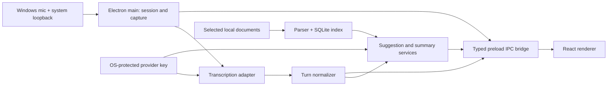

# Orivox architecture

Status: **Agreed for MVP** by Codex and Google Antigravity through Concord on 2026-10-29. Implementation details below remain subject to milestone tests.

## Process boundaries

The Electron **main process** owns window and shortcut lifecycle, capture authorization/orchestration, provider connections, document processing, SQLite, and credentials. A dedicated capture context may perform browser media-device calls under main-process control; M1 will choose the concrete Windows adapter. The **preload** exposes only typed, validated calls and events. The sandboxed **React renderer** owns the interface and has no Node access or credentials. `src/shared` holds the contract and synthetic fixtures so renderer work can be tested without native audio.

## Session pipeline

1. Renderer presents a per-session consent form and sends source choices and consent flags over the bridge. Main validates them before capture.
2. Main authorizes and orchestrates the selected system loopback and/or microphone independently; the capture context performs media-device calls where Electron requires it. The first technical spike must verify the Electron Windows capture path against a real call; if it is inadequate, the capture adapter can be replaced without changing the renderer contract.
3. A live transcription adapter emits partial and final text. Main normalizes final utterances with timestamps and a **capture-source** label. It does not infer speaker identity from the source.
4. On-demand suggestion uses recent completed turns. Automatic question detection runs only on completed turns, with a toggle, deduplication, and cooldown. Suggestions are short, grounded, and carry evidence references.
5. User-selected TXT/PDF/DOCX content is parsed locally, chunked, and indexed in SQLite (including full-text search where suitable). Retrieval sends only relevant snippets and necessary conversation context to the AI provider.
6. Ending a session stops capture and provider streams, then optionally generates a reviewable summary. The user decides whether to save transcript or summary.

## Architectural decisions

| ID | Decision | Reason / verification |
| --- | --- | --- |
| ADR-001 | Single-user local Electron app, React + TypeScript UI, SQLite data store; no hosted Orivox backend for MVP. | Keeps the first release small and local. Provider calls still require network access and explicit disclosure. |
| ADR-002 | Main/preload/renderer boundary with context isolation, sandbox, no renderer Node integration, narrow validated IPC. | Limits the impact of untrusted transcript and document text. Verify in M0/M1 security review. |
| ADR-003 | Separate mic and system capture adapters; prove Windows loopback in M1. | Audio routing is the largest feasibility risk. A replaceable adapter avoids coupling UI to a particular capture method. |
| ADR-004 | Live transcription first; suggestions consume normalized completed turns. | Prevents repeated generation on unstable partial text. Provider choice is an adapter decision and is checked for latency/cost in M2. |
| ADR-005 | Local document index with selective snippet retrieval. | Gives grounded context while minimizing data sent externally. Verify parser quality and citations in M5. |
| ADR-006 | Raw audio never stored by default; transcript/summary persistence requires explicit user save. | Supports privacy expectations for real conversations. Verify stop/delete/retention behavior in M6. |
| ADR-007 | Synthetic typed events and mock bridge in M0. | Lets Antigravity build and test renderer independently of native capture. |

## Ownership

| Area | Owner | Boundary |
| --- | --- | --- |
| `src/main/**` | Codex | Windows capture, session state, provider adapters, document indexing, SQLite, security, packaging integration. |
| `src/preload/**` | Codex | Narrow IPC bridge and validation boundary. |
| `src/shared/**` | Codex, with Antigravity review through Concord | Types, event protocol, deterministic mock fixtures. Changes require a Concord proposal before edits. |
| `src/renderer/**` | Antigravity | Consent UI, transcript, suggestions, document selector, summary/settings, UI tests. No direct Node or provider access. |
| `docs/**` and integration decisions | Codex lead; Antigravity reviews relevant contracts | Concord records decisions, progress, handoffs, tests, and risks. |

## Open risks

- Electron system loopback availability varies by Windows version, source, and call application. M1 must prove capture with Teams/Zoom/Meet and audio device changes.
- Live transcription may return deltas without trustworthy speaker IDs or word timings. UI labels remain capture source only.
- Real-time cloud processing has latency, outage, and cost exposure. M2 measures each; degraded mode must show a clear error.
- PDF/DOCX extraction may be poor for scanned or complex documents. M5 defines supported cases and an explicit unsupported warning.
- A visible app-level capture indicator alone may not satisfy every meeting policy or legal requirement. The consent flow reminds the user to obtain required permission and follow the conversation's rules.

## Reference documentation

- [Electron desktop capture](https://www.electronjs.org/docs/latest/api/desktop-capturer) and [session display-media handler](https://www.electronjs.org/docs/latest/api/session) describe the Windows loopback path to test in M1.
- [Electron security guidance](https://www.electronjs.org/docs/latest/tutorial/security) and [context isolation](https://www.electronjs.org/docs/latest/tutorial/context-isolation) inform the process boundary.
- [OpenAI Realtime transcription](https://developers.openai.com/api/docs/guides/realtime-transcription) documents a candidate live transcription adapter; provider selection and measured performance are M2 decisions.
